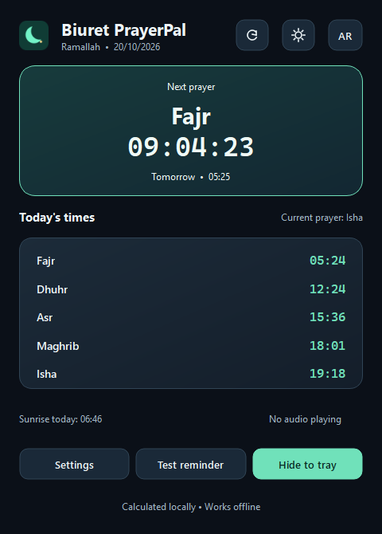

# Biuret PrayerPal — V1.0.1

[What changed in 1.0.1?](docs/RELEASE_V1.0.1.md) · [Verification details](docs/V1.0.1_REVIEW.md)

### A calm companion for prayer and remembrance

A Windows desktop app with offline prayer-time calculations, a next-prayer countdown,
customizable prayer/Azkar reminders, Arabic RTL / English LTR UI, and local preferences.

[العربية](README.md) · [Download Windows release](https://github.com/Biuret7/Biuret-PrayerPal/releases/tag/V1.0.1)



## Install without Python

Download `BiuretPrayerPal-V1.0.1-Setup-Windows-x64.exe` from the [V1.0.1 release](https://github.com/Biuret7/Biuret-PrayerPal/releases/tag/V1.0.1).
The primary download is now a **Windows installer**. Run its wizard, then open the app
from Start. It installs for your current account without administrator elevation,
with a Start shortcut, optional desktop shortcut, and Windows uninstall entry.
Preferences survive reinstall/uninstall. [Installer and build guide](docs/INSTALLER.md).
No Python installation is required. Both installer and app are unsigned.
Configure your city and time zone before relying on its reminders.

## Try the included Adhan — no extra file needed

**The Adhan / The Call to Prayer — Omar Hisham Al Arabi** is included inside the EXE
and at [assets/sounds/adhan-omar-hisham-al-arabi.mp3](assets/sounds/adhan-omar-hisham-al-arabi.mp3).

1. In 1.0.1, click **EN** in the header, then open **Settings → Sound**.
2. Select **Omar Hisham Al Arabi Adhan (included)**.
3. Turn Mute off, set volume above zero, and click **Test reminder**.
4. Use **Stop audio**, which appears during playback, to stop the recording.

In published 1.0.0 these controls are **الإعدادات → الصوت → أذان عمر هشام العربي (مرفق)**,
then **اختبار التذكير** and **إيقاف الصوت**.

The default remains the short chime; the included recording plays when selected.
Personal Adhan and Azkar files are also supported. See the [recording credit](assets/sounds/README.md).

## Features

- Five daily prayers, sunrise, next-prayer highlighting, and tomorrow's Fajr countdown.
- Custom coordinates/city, IANA time zone, Fajr/Isha angles, Asr method, and minute adjustments.
- Optional early alerts at 5/10/15/30 minutes and independent morning/evening Azkar times.
- Five popup positions, fade/slide/zoom, custom colors/borders, and reduced motion.
- Dark/light themes, current-value previews before saving, volume/mute, and system tray operation.
- Local QSettings persistence and single-instance protection.
- English/Arabic switch via AR / EN in the header or Settings → App → Language.
- Animated theme switching; respects the reduced-motion preference.
- Optional startup via Settings → App → Start PrayerPal when I sign in to Windows.

Startup changes apply only on Save; Cancel and Test Reminder do not register anything.
Startup opens in the notification area when available, otherwise shows the main window.
The current prayer appears above the timetable; sunrise is explicitly today's solar
information. Stop Audio appears during playback; an informative label appears when idle.

Prayer times are adjustable astronomical estimates, not an official timetable. Compare with
local published times. Alerts require the computer and application to be running; events
older than the 90-second catch-up window are not replayed after long sleep. Glass styling
is simulated in Qt. Native Windows/audio smoke checks do not certify every PC or codec.

## Source and build

```powershell
git clone https://github.com/Biuret7/Biuret-PrayerPal.git
Set-Location Biuret-PrayerPal
py -m venv .venv
& .\.venv\Scripts\python.exe -m pip install -r requirements.txt
& .\.venv\Scripts\python.exe prayerpal.py
```

The binding is **PySide6**, not PyQt6. To package the app, run `build_exe.bat` or follow
[BUILD_WINDOWS.md](docs/BUILD_WINDOWS.md). Read-only assets are bundled; user preferences
and personal audio paths are never copied into a public build.

```powershell
py -m pip install -r requirements-dev.txt
py prayerpal.py --self-test
py -m unittest discover -s tests/gui -v
```

Core/build tests and Qt/audio checks are separate. The normal build verifies the actual
frozen EXE with muted playback and isolated test settings, then publishes to `release/`.

Product wording draws on the owner's Arabic/English PrayerPal canvases, updated to match
this release. No open-source license has yet been selected for the application code.
The recording has separate rights. See [third-party notices](packaging/THIRD_PARTY_NOTICES.txt)
and [audio attribution](assets/sounds/README.md).
