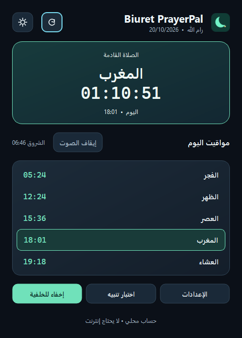
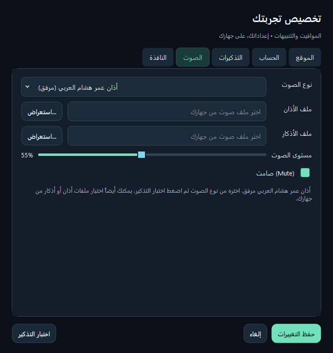
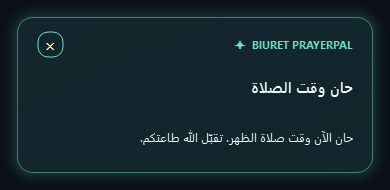

# Biuret PrayerPal — V1.0.0

### رفيقك اليومي للصلاة والذكر

تطبيق Windows يعرض مواقيت الصلاة والصلاة القادمة مع عدّ تنازلي، ويقدّم تذكيرات صلاة
وأذكار قابلة للتخصيص. الحساب محلي، والإعدادات محفوظة على جهازك.

[English](README.en.md) · [تنزيل إصدار Windows](https://github.com/Biuret7/Biuret-PrayerPal/releases/tag/V1.0.0) · [الأذان المرفق](assets/sounds/adhan-omar-hisham-al-arabi.mp3)



## تثبيت البرنامج بدون Python

1. افتح [صفحة V1.0.0](https://github.com/Biuret7/Biuret-PrayerPal/releases/tag/V1.0.0).
2. نزّل `BiuretPrayerPal-V1.0.0-Windows-x64.exe` واتبع معالج التثبيت، ثم افتحه من قائمة Start.
3. افتح الإعدادات وحدد المدينة والمنطقة الزمنية، ثم جرّب التنبيه.

التنزيل الأساسي الآن Installer لويندوز x64 ولا يحتاج إلى Python أو صلاحيات مسؤول.
يثبّت لحسابك الحالي، ويضيف اختصار Start وخيار اختصار سطح المكتب، ويدعم الإزالة من
إعدادات Windows مع إبقاء تفضيلاتك. [دليل التثبيت والبناء](docs/INSTALLER.md).
المثبّت والبرنامج غير موقّعين رقمياً.
التحقق المحلي تم على Windows مع Python 3.14 وQt 6.12؛ لا نعلن اعتماداً لكل أجهزة Windows.

## جرّب الأذان المرفق مباشرة

الإصدار يتضمن **الأذان بصوت عمر هشام العربي — The Adhan / The Call to Prayer**.

**الإعدادات ← الصوت ← «أذان عمر هشام العربي (مرفق)» ← «اختبار التذكير»**.

ألغِ «صامت» واضبط مستوى الصوت فوق الصفر. لا تحتاج إلى إحضار ملف أو تنزيل تسجيل آخر؛
الأذان موجود داخل EXE وفي [هذا الملف داخل المستودع](assets/sounds/adhan-omar-hisham-al-arabi.mp3).
يمكن إيقاف التسجيل من زر **إيقاف الصوت** في النافذة الرئيسية أو قائمة شريط النظام.

الصوت الافتراضي يبقى النغمة الهادئة؛ تشغيل الأذان المرفق يكون باختيارك. ملفات الأذان
والأذكار الشخصية تبقى مدعومة أيضاً. [نسبة التسجيل ومعلومات الملف](assets/sounds/README.md).



## الميزات

- الفجر، الظهر، العصر، المغرب والعشاء، مع وقت الشروق.
- إبراز الصلاة القادمة وعدّ تنازلي، بما في ذلك فجر اليوم التالي.
- مدن جاهزة أو إحداثيات ومدينة مخصصة، ومنطقة زمنية قابلة للاختيار.
- ضبط زوايا الفجر والعشاء وطريقة العصر وتصحيح دقائق كل صلاة.
- تنبيه مبكر اختياري: 5 أو 10 أو 15 أو 30 دقيقة.
- تذكيرات صباحية ومسائية للأذكار بأوقات مستقلة.
- خمسة مواضع للإشعار، وحركات Fade وSlide وZoom، وألوان وحدود قابلة للتخصيص.
- مظهر داكن وفاتح، وواجهة عربية باتجاه RTL وخيار تقليل الحركة.
- زر تجربة يستخدم الإعدادات الحالية قبل حفظها، مع تحكم بالصوت والكتم.
- تشغيل بالخلفية عبر شريط النظام، ومنع تكرار تشغيل التطبيق.



## ملاحظات الاستخدام

المواقيت تقديرات فلكية قابلة للتعديل وليست جدولاً رسمياً معتمداً؛ قارنها بتقويمك المحلي.
التنبيهات تتطلب بقاء التطبيق والجهاز قيد التشغيل. بعد تأخر طويل أو سكون لا يعاد تشغيل
جميع التنبيهات القديمة؛ نافذة الالتقاط أقل من 90 ثانية. المظهر الزجاجي محاكاة داخل Qt.

## التشغيل من المصدر

```powershell
git clone https://github.com/Biuret7/Biuret-PrayerPal.git
Set-Location Biuret-PrayerPal
py -m venv .venv
& .\.venv\Scripts\python.exe -m pip install -r requirements.txt
& .\.venv\Scripts\python.exe prayerpal.py
```

الإطار المستخدم هو **PySide6 / Qt 6**، والإعدادات المحلية تستخدم `QSettings`.
الحساب لا يستدعي API خارجياً، والملفات الصوتية المرفقة تعمل محلياً.

## بناء EXE والاختبارات

شغّل `build_exe.bat`، أو اتبع [دليل بناء Windows الكامل](docs/BUILD_WINDOWS.md).

```powershell
py -m pip install -r requirements-dev.txt
py prayerpal.py --self-test
py -m unittest discover -s tests/gui -v
```

اختبارات المنطق والبناء منفصلة عن اختبارات Qt والصوت. لا تعتبر حالة عدم توفر جهاز صوت
نجاحاً لتشغيل التسجيل. بناء `build.py` يفحص EXE الحقيقي بأصوات مكتومة وإعدادات معزولة
قبل وضعه في `release/`، ويحفظ سجلاته محلياً تحت `artifacts/build/`.

## بنية المشروع

| المسار | المسؤولية |
| --- | --- |
| `prayerpal.py` | التشغيل وحماية النسخة الواحدة |
| `biuret_prayerpal/core.py` | الحساب الفلكي والمنطقة الزمنية |
| `preferences.py` / `reminders.py` | التفضيلات والجدولة |
| `storage.py` | الحفظ والاسترجاع عبر QSettings |
| `sound.py` / `popup.py` | الصوت وطابور التنبيهات والنوافذ المتحركة |
| `dialogs.py` / `main_window.py` / `theme.py` | الواجهة والإعدادات والمظهر |
| `assets/sounds/` | النغمة والأذان المرفق ومعلومات النسبة |
| `build.py` / `BiuretPrayerPal.spec` | بناء Windows والتحقق والتنظيف الآمن |

وصف المنتج يستفيد من مخططي PrayerPal العربي والإنجليزي اللذين قدّمهما صاحب المشروع،
مع تحديث الميزات ورقم الإصدار بحسب الشيفرة الحالية.

## الحقوق والمكونات الخارجية

راجع [نسب التسجيل](assets/sounds/README.md) و[إشعارات المكونات الخارجية](packaging/THIRD_PARTY_NOTICES.txt).
لا يتضمن المستودع حالياً ترخيصاً مفتوحاً للشيفرة، ولا تمنح إتاحة التسجيل ترخيصاً مفتوحاً له.
