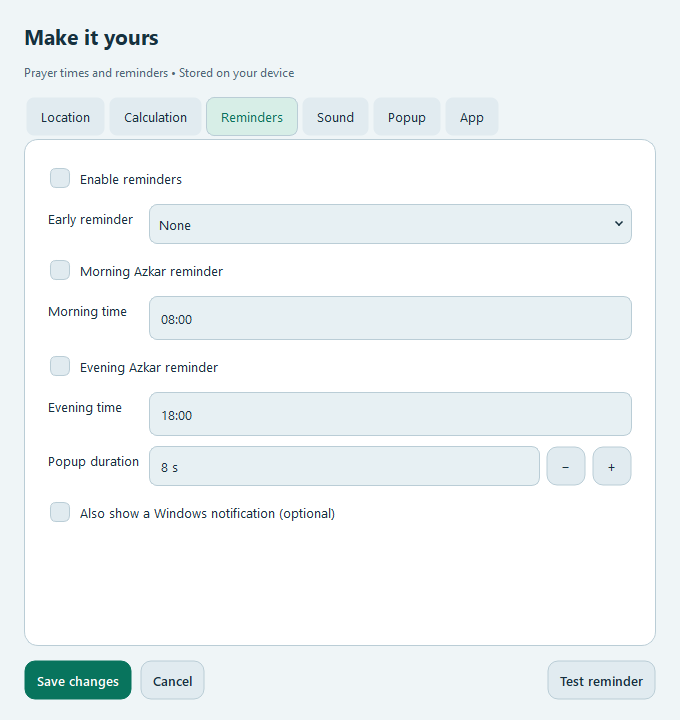

> تقرير الفحص المحلي بتاريخ 2026-10-20 قبل اعتماد النشر. عبارات «غير منشور»
> أدناه توثّق حالة الحزمة وقت الفحص. ملاحظات الإصدار المعتمدة بتاريخ
> 2026-10-21 في [RELEASE_V1.0.1.md](RELEASE_V1.0.1.md).

# إصلاح تعديل مدة ظهور النافذة — 1.0.1 محلي

أبلغ المستخدم أن حقل «مدة ظهور النافذة» لا يسمح له بتغيير المدة. التحقق أظهر أن
الكتابة اليدوية ما زالت تعمل، لكن أزرار SpinBox الأصلية كانت مخفية ضمن معالجة
شكل حقول Qt، فلم يعد الحقل يوفر طريقة واضحة للتعديل بالماوس.

أضيف زران مستقلان **− و+** بجانب الحقل، مع أسماء وصول وتلميحات بالعربية والإنجليزية.
كل نقرة تغيّر المدة ثانية واحدة. المدى الحالي **4–30 ثانية**، وتوضح تلميحة الحقل
هذا المدى. يتعطل زر النقصان عند 4 وزر الزيادة عند 30؛ الكتابة المباشرة ما زالت
متاحة. هذا يحافظ على إصلاح عرض النص وزوايا الحقول في Qt 6.12.

اختبار Qt الجديد يغطي الماوس والكتابة، والحدين الأدنى والأعلى، ومعاينة التذكير،
وصول 30 ثانية فعلياً إلى مؤقّت Toast، والحفظ وإعادة فتح الإعدادات، بالعربية
والإنجليزية وفي المظهرين. فحص EXE المجمّع يتأكد أيضاً من أن زر الزيادة يغيّر
قيمة المعاينة. مؤقّت النافذة المخصصة يستخدم القيمة المختارة؛ إشعار Windows
الإضافي يخضع لسلوك نظام التشغيل.

المثبّت وحزمة المصدر والبصمات أعيد تجهيزها محلياً بنفس رقم 1.0.1 لأنه لم يُنشر.
الحزمة السابقة محفوظة في `artifacts/before-duration-fix-*/`.
لم يتم تغيير إعدادات المستخدم أو نشر تحديث على GitHub.

