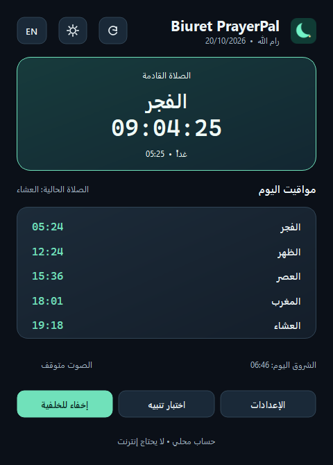
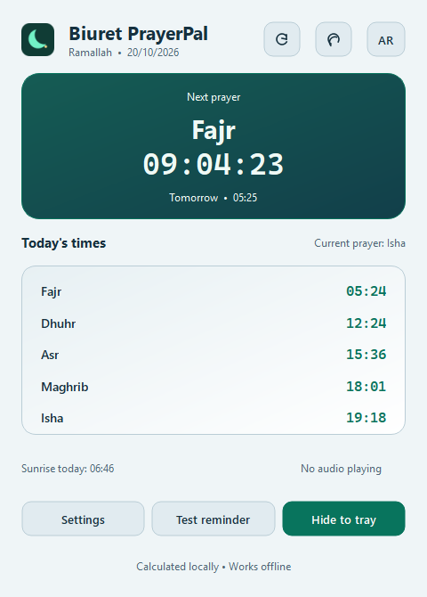
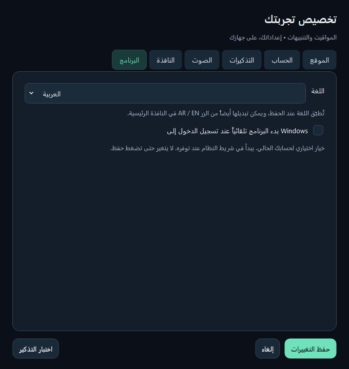
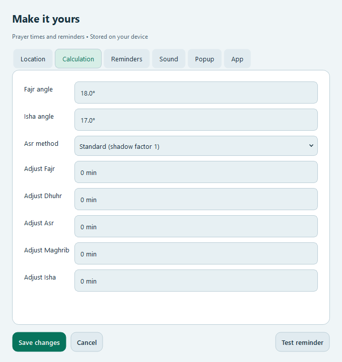

> تقرير الفحص المحلي بتاريخ 2026-10-20 قبل اعتماد النشر. عبارات «غير منشور»
> أدناه توثّق حالة الحزمة وقت الفحص. ملاحظات الإصدار المعتمدة بتاريخ
> 2026-10-21 في [RELEASE_V1.0.1.md](RELEASE_V1.0.1.md).

# Biuret PrayerPal 1.0.1 — نسخة محلية غير منشورة

هذه النسخة تحضّر تحديث 1.0.1 للمراجعة والتجربة. لم يتم رفع ملفات أو إنشاء tag أو
release أو تغيير ملف حساب GitHub. الإصدار المنشور 1.0.0 وملفاته المحلية محفوظة.
الإطار الفعلي للمشروع هو **PySide6 / Qt 6**؛ لم تُخلط معه مكتبات PyQt6.

## التغييرات بحسب الملاحظات

| الملاحظة | التنفيذ |
| --- | --- |
| بقاء حدود الزر بعد النقر | فصل تركيز الماوس عن تركيز لوحة المفاتيح في `HoverButton`. يزول التوهج عند مغادرة المؤشر، وتبقى علامة التركيز عند Tab وShift+Tab والاختصارات. |
| زر إيقاف الصوت غير قابل للنقر | استبداله بحالة نصية عند السكون، وإظهار الزر أثناء التشغيل فقط. مساحة العنصر ثابتة لمنع تحرك التخطيط. |
| الشروق ظاهر أثناء العشاء | إضافة عنوان «الصلاة الحالية»، وكتابة «الشروق اليوم» مع شرح أنه معلومة فلكية منفصلة عن الصلاة الحالية والقادمة. |
| حركة زر المظهر | دوران وتلاشي بين الشمس والهلال عبر `QPropertyAnimation`، مع انتقال بين المظهرين. التعامل مع النقر المتكرر وتغيير الحجم وخيار تقليل الحركة. |
| التشغيل مع Windows | خيار اختياري في الإعدادات ← البرنامج، يبدأ عند تسجيل دخول الحساب الحالي، ويخفي النافذة إلى شريط النظام عند توفره. |
| زوايا الإعدادات | إبقاء صفحات التمرير وواجهاتها شفافة داخل حدود مستديرة، وإزالة تعبئة الخلفية التي كانت ترسم زوايا مربعة. تطبيقها على الصفحات الست. |
| اللغة الإنجليزية | زر EN / AR في الرأس، وخيار اللغة في الإعدادات ← البرنامج. ترجمة الواجهة والإعدادات وقائمة شريط النظام والمعاينات والتنبيهات والأخطاء المعروفة. |
| تعديل مدة ظهور النافذة | زرا − و+ مستقلان مع كتابة مباشرة وتوضيح مدى 4–30 ثانية، وحماية الحدين؛ [تفاصيل الإصلاح](DURATION_FIX.md). |

## تحسينات البنية والحفظ

- `i18n.py`: قاموس محلي وترجمة النصوص الثابتة وأسماء الصلاة والأوقات. العربية RTL
  والإنجليزية LTR. أسماء المدن الجاهزة تحتفظ بقيمها الأصلية في `itemData`؛ ترجمة
  العرض لا تغيّر بيانات الحساب. أسماء المدن المخصصة ومسارات المستخدم لا تُترجم.
- `startup.py`: بناء أمر تشغيل مقتبس للمسارات التي تحتوي مسافات، واستخدام
  `pythonw.exe` للمصدر إن توفر، و`sys.executable --startup` للنسخة المجمّعة.
  التسجيل في HKCU Run، بالقيمة المملوكة `BiuretPrayerPal`، دون صلاحيات مسؤول.
- `commit_preferences`: التحقق من التفضيلات قبل تعديل Windows، وإرجاع قيمة Run
  السابقة إذا فشل حفظ التفضيلات. فشل التسجيل لا يُعرض كحفظ ناجح. الإلغاء والمعاينة
  وتبديل اللغة/المظهر لا يفعّلان بدء التشغيل.
- `preferences.py` / `storage.py`: إضافة `language` و`start_on_login` إلى السجل
  الحالي دون تغيير مسار البيانات أو معرّفات التنبيهات أو إسقاط التفضيلات السابقة.
  التفضيلات القديمة تبدأ بالعربية وبدء التشغيل معطل افتراضياً.
- `main_window.py`: إعادة بناء العرض عند تبديل اللغة مع الحفاظ على محرك الصوت
  وطابور التنبيهات والمؤقت وسجل الإرسال؛ عدم إعادة إصدار التنبيهات المرسلة.
- `sound.py`: خاصية قراءة عامة لحالة التشغيل تربط العنصر المرئي بإشارة الصوت.
- `installer.nsi`: إزالة أمر بدء التشغيل فقط إن طابق مسار هذا التثبيت تماماً؛
  أي أمر يشير لنسخة أخرى يبقى محفوظاً.
- البناء ينتج أسماء ملفات مرتبطة بالإصدار، ويحافظ على الملفات السابقة. لا تنشر
  أدوات البناء شيئاً على GitHub؛ مخرجاتها محلية تحت `release/`.

## إصلاح إضافي كشفته المراجعة البصرية

في Qt 6.12، جمع QSS مع `QAbstractSpinBox.NoButtons` في LTR أعطى محرر بعض الحقول
عرضاً مقداره بكسل واحد. بقيت القيم محفوظة لكنها لم تظهر بالإنجليزية. المعالجة
تحافظ على وضع الأسهم الأصلي، وتجعل عرض أزرار الأسهم صفراً عبر QSS، وتزيل رسمها
وتضيف هامشاً داخلياً للنص. النتيجة حقول واضحة دون مربعات أسهم مقصوصة، مع استمرار
الكتابة والتعديل بلوحة المفاتيح والعجلة. أضيف اختبار لمساحة النص وقيمته وتعديله
بالعربية والإنجليزية وفي المظهرين، وفحص مماثل داخل EXE المجمّع.

## التحقق

بيئة الفحص المحلية: Windows x64، Python 3.14.6، PySide6 / Qt 6.12.0،
PyInstaller 6.21.0، NSIS 3.13.

| الفحص | النتيجة |
| --- | --- |
| اختبارات المنطق والحفظ والبناء | 40/40 PASS |
| اختبارات Qt والعمليات على Windows | 31/31 PASS |
| اختبارات Qt والعمليات offscreen | 31/31 PASS |
| PEP 8 وتجميع المصدر | PASS |
| صور الواجهة الأصلية والعربية/الإنجليزية | تم توليدها ومراجعة الشاشات الأساسية والإعدادات |
| EXE الفعلي | PASS: أيقونة، موارد، مناطق زمنية، حساب، معاينة، إنجليزية، عرض الأرقام، حركة المظهر، نافذة مرئية |
| صوت EXE الفعلي | PASS: WAV إلى EndOfMedia، والأذان MP3 تقدم في التشغيل؛ المخرج مكتوم أثناء الفحص |
| المثبّت النهائي | PASS: بناء NSIS بتحويل التحذيرات إلى أخطاء، وتحقق x64/الإصدار وفحص payload الفعلي |
| دورة التثبيت والإزالة | PASS بهوية اختبار معزولة، مع payload مطابق للمثبّت النهائي؛ التفاصيل أدناه |

اختبارات بدء التشغيل تستخدم مفتاح سجل فريداً تجريبياً، ولا تغيّر خيار بدء التشغيل
الحقيقي. فُحص أيضاً التراجع عند فشل الحفظ، رفض القيم غير الصالحة، منع تكرار
التنبيه عند تغيير اللغة، ثبات مساحة الأزرار، التركيز بالماوس ولوحة المفاتيح،
والنقر المتكرر على المظهر وتقليل الحركة.

فحص دورة التثبيت بالهوية الإنتاجية **رُفض بأمان لوجود اختصار مسبق**. لم يُحذف
الاختصار ولم يتم استبداله. بُني نفس `installer.nsi` باستخدام
`--validation-namespace` لتغيير هوية سجل Windows والاختصارات والمجلد الافتراضي
والـmutex فقط. فحص هذه النسخة يغطي مساراً عربياً يحتوي مسافات، ورفض مجلد غير
مملوك، وإعادة التثبيت، ورفض EXE المقفول، وتشغيل التطبيق المثبّت، والإزالة مع
حماية ملف مستخدم، وتنظيف أمر بدء التشغيل المطابق وحماية غير المطابق.
السجل والاختصارات الإنتاجية والتفضيلات قورنت قبل الفحص وبعده وبقيت مطابقة.

هذا تحقق لمنطق المثبّت معزولاً، وليس ادعاء بتثبيت ملف Setup الإنتاجي فوق نسختك
الشخصية. تبقى قيمة `install_lifecycle_tested` للإنتاج `false`، ويُحفظ إثبات
الفحص المعزول بشكل منفصل. نسخة الاختبار تحت `artifacts/` ليست للتوزيع.

## الملفات النهائية

- للمستخدم: `release/BiuretPrayerPal-V1.0.1-Setup-Windows-x64.exe`.
- payload للبناء: `release/BiuretPrayerPal-V1.0.1-Windows-x64.exe`.
- المصدر الكامل: `release/Biuret-PrayerPal-V1.0.1-source.zip`.
- بصمة SHA-256 بجانب كل ملف؛ [ملخص التحقق والبصمات](V1.0.1_VERIFICATION.json).
- [دليل البناء](BUILD_WINDOWS.md) و[دليل المثبّت](INSTALLER.md).
- استرداد المصدر قبل التعديل محفوظ محلياً تحت `artifacts/before-v1.0.1-*.zip`.
- السجلات الكاملة تحت `artifacts/`؛ التقارير التاريخية وملفات manifest القديمة
  تخص لقطاتها السابقة، ويخص `V1.0.1_SOURCE_MANIFEST.json` حزمة المصدر الحالية.

## تجربة النسخة محلياً

1. اخرج من PrayerPal من شريط النظام قبل إعادة التثبيت، حتى لا يبقى EXE مقفولاً.
2. شغّل Setup 1.0.1، ثم افتح البرنامج من Start، وتحقق من المدينة والمنطقة الزمنية.
3. جرّب زر EN / AR، والمظهر الفاتح/الداكن، ثم الإعدادات ← البرنامج.
4. اختبر الصوت من الإعدادات ← الصوت: اختر الأذان المرفق، وألغ الكتم وارفع مستوى
   الصوت، ثم اختبار التذكير. أثناء التشغيل يظهر زر إيقاف الصوت في النافذة الرئيسية.
5. لتجربة بدء التشغيل، فعّل الخيار واحفظ ثم سجّل الخروج والدخول يدوياً عندما
   يناسبك. لم يُعد الفحص تشغيل جهازك أو تسجيل خروجك.

لم تُختبر جلسة تسجيل دخول بشرية فعلية، أو جهاز Windows نظيف بلا أدوات تطوير،
أو قارئ الشاشة Narrator وتكبير DPI على أجهزة فعلية متعددة، أو جميع أجهزة الصوت
والشاشات. المثبّت والبرنامج غير موقّعين رقمياً. هذه نقاط تحقق قبل النشر لاحقاً،
ولا توجد عملية نشر معلّقة أو مجدولة تلقائياً.

